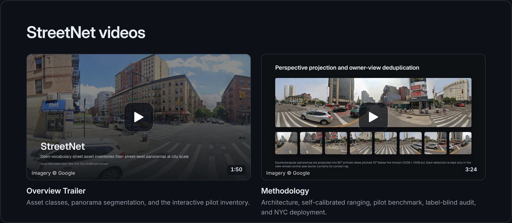
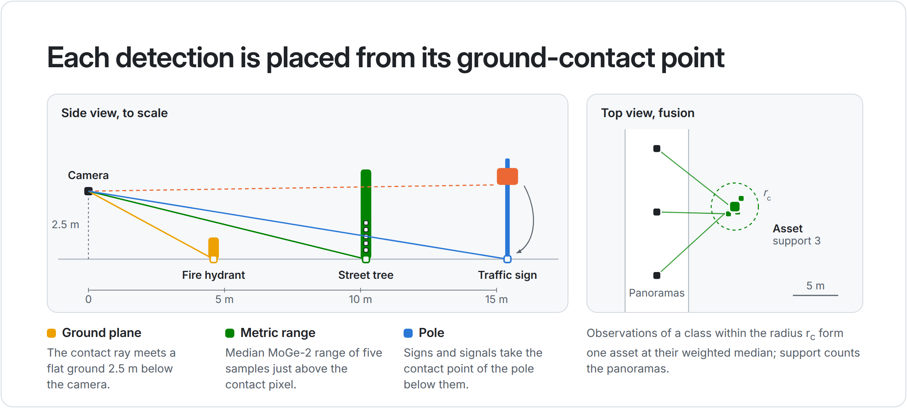
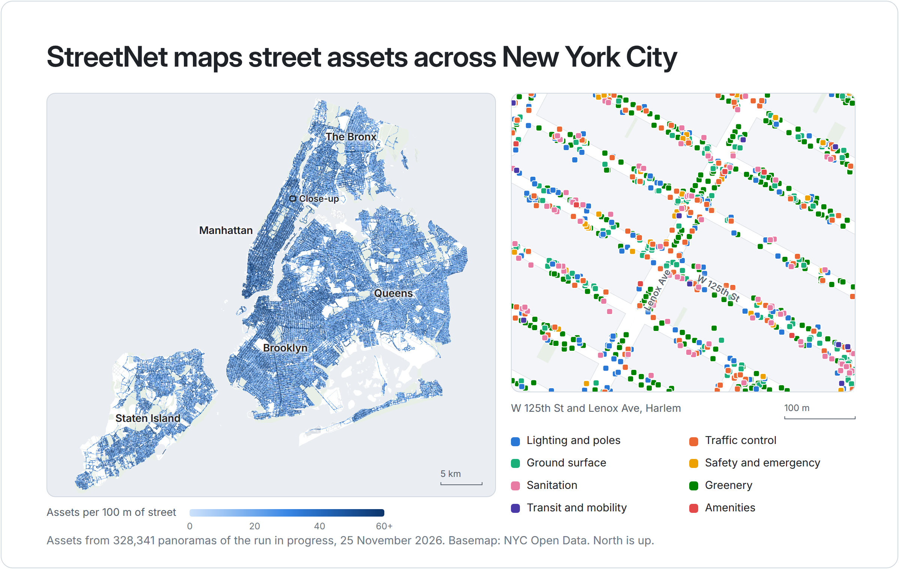

<picture>
  <source media="(prefers-color-scheme: dark)" srcset="docs/assets/figures/hero-dark.jpg">
  
</picture>

**StreetNet** constructs georeferenced street asset inventories directly from street-level panoramas without task-specific training. It segments 22 classes of street furniture and infrastructure per panorama using SAM 3.1 and Mask2Former, localizes each instance via zero-GT road-plane self-calibrated MoGe-3 metric geometry and ground-plane intersection with automatic car-occlusion switching, and fuses multi-view observations with bounded clustering, zero-GIS spatial context priors, occlusion-aware support, and zero-shot multi-distractor SigLIP 2 verification.

[](https://github.com/mkturkcan/streetnet/actions/workflows/ci.yml)
[](https://huggingface.co/datasets/mehmetkeremturkcan/streetnet-nyc)
[](pyproject.toml)
[](LICENSE)

**[Project Page](https://mkturkcan.github.io/streetnet/)** &emsp; **[Method](docs/method.md)** &emsp;
**[Data Formats](docs/data.md)** &emsp; **[Evaluation](docs/evaluation.md)** &emsp;
**[NYC Asset Map](https://huggingface.co/datasets/mehmetkeremturkcan/streetnet-nyc)** &emsp; **[Map Viewer](https://huggingface.co/spaces/mehmetkeremturkcan/streetnet-viewer)** &emsp; **[Citation](#citation)**

## Quickstart

```bash
git clone -b v2 https://github.com/mkturkcan/streetnet.git && cd streetnet
pip install -e ".[detect]"     # detection & verification: Linux, NVIDIA GPU, Python 3.10 to 3.12
hf auth login                  # SAM 3.1 is gated; accept its license at huggingface.co/facebook/sam3.1 first
```

```bash
# 1. Per-panorama GPU detection (SAM 3.1 + Mask2Former + road-plane self-calibrated MoGe-3 ViT-G)
streetnet detect --index panos.parquet --images panoramas/ --out runs/city --gpus 0,1,2,3

# 2. Tiled CPU fusion with zero-GIS crosswalk/manhole priors and occlusion-aware clear-view counting
streetnet map --index panos.parquet --run runs/city --name city --defer-verify

# 3. Multi-GPU zero-shot SigLIP 2 candidate verification and final filtering
streetnet verify --index panos.parquet --images panoramas/ --run runs/city \
    --map runs/city/map/city_assets.parquet --out runs/city/map/city_verified_assets.parquet --gpus 0,1,2,3

# 4. Evaluation against municipal reference points (with optional NAD83(2011)-to-ITRF2020 alignment)
streetnet eval --index panos.parquet --map runs/city/map/city_verified_assets.parquet \
    --gt reference.parquet --gt-datum nad83
```

The panorama index contains one row per panorama (`pano_id`, `lat`, `lon`, and `heading`); municipal reference points specify `gt_key`, `lon`, and `lat` (see [docs/data.md](docs/data.md)). Mapping and evaluation run on CPUs and require only `pip install -e .`. Omitting `--defer-verify` produces a ready-to-use CPU map directly from `streetnet map` without running `streetnet verify`.

<details>
<summary>Installation notes</summary>

- Model checkpoints for SAM 3.1 (`facebook/sam3.1`), Mask2Former (`facebook/mask2former-swin-large-mapillary-vistas-panoptic`), MoGe-3 (`Ruicheng/moge-3-vitg`), and SigLIP 2 (`google/siglip2-so400m-patch16-384`) download automatically on first use.
- MoGe-3's sparse volumetric refinement requires `flex_gemm`; pass `--depth-model moge2` if running in an environment without `flex_gemm`.
- SAM 3.1 uses the `sam3` codebase (requiring NumPy `< 2.0`) and loads `sam3.1_multiplex.pt` by default.
- MoGe depends on `opencv-python`, which requires `libGL`. On headless servers or CUDA containers without `libGL`, run `pip uninstall -y opencv-python && pip install opencv-python-headless`.
- Pass `--compile` to `streetnet detect` to compile SAM 3.1 via PyTorch 2 at startup. Monitor progress with `streetnet status --index panos.parquet --run runs/city`.
- Verified with Python 3.11, PyTorch 2.12 (CUDA 13.0), `transformers` 5.8.1, SAM 3 commit `96914d2`, and MoGe commit `74fbce0`.

</details>

## Videos

<a href="https://mkturkcan.github.io/streetnet/#videos"></a>

## Pipeline overview

<picture>
  <source media="(prefers-color-scheme: dark)" srcset="docs/assets/figures/overview-dark.jpg">
  
</picture>

Each equirectangular panorama is projected into perspective views. SAM 3.1 segments 34 natural-language prompts in a single batch, Mask2Former (Mapillary Vistas) segments road-surface curb ramps, catch basins, and street-scene semantics, and MoGe-3 (ViT-G) estimates metric 3D point maps self-calibrated per panorama against unobstructed road pixels (`geometry.fit_road_plane_scale`).

<picture>
  <source media="(prefers-color-scheme: dark)" srcset="docs/assets/figures/pipeline-dark.png">
  
</picture>

The pipeline decouples GPU detection from CPU mapping. Detection writes compact per-panorama Parquet records alongside lightweight crosswalk point clouds and compressed 1-bit occlusion masks; mapping projects detections into a metric UTM coordinate frame and fuses observations in parallel across 1 km tiles; optional GPU verification filters fused candidates once per physical asset with zero-shot SigLIP 2.

<picture>
  <source media="(prefers-color-scheme: dark)" srcset="docs/assets/figures/placement-dark.png">
  
</picture>

Street trees, street lights, signs, signals, benches, and bike racks are localized using self-calibrated MoGe-3 metric range, whereas unoccluded ground and surface classes intersect a leveled ground plane 2.5 m below the camera. Whenever a parked vehicle occludes an object's base (`base_veh >= 0.35`), localization automatically switches to vehicle-masked interior range (`d_mask`). Pole-mounted signs and signals inherit the contact ray and range of their supporting pole. Full pseudocode and constants are detailed in [docs/method.md](docs/method.md).

## Asset classes

<picture>
  <source media="(prefers-color-scheme: dark)" srcset="docs/assets/figures/classes-dark.png">
  
</picture>

Classes are defined by natural-language prompts in [`streetnet/configs/prompts.json`](streetnet/configs/prompts.json) and can be customized via `--vocabulary`; curb ramps come from Mask2Former and catch basins ensemble SAM 3.1 with Mask2Former. See the [class table](docs/method.md#classes) for mount types and localization estimators.

## New York City benchmark and asset map

<picture>
  <source media="(prefers-color-scheme: dark)" srcset="docs/assets/figures/nyc_map-dark.jpg">
  
</picture>

In the Upper Manhattan pilot (9,652 held-out panoramas, 31,562 NAD83(2011)-to-ITRF2020 datum-aligned municipal reference points), StreetNet reaches **0.569 F1 at 3 m** (`0.641` at 5 m) across the eight surveyed inventories (+13.1 F1 points over the strongest localization and fusion baseline) and **0.364 F1 at 3 m** across all 14 municipal layers. In a 7,901-judgment strictly label-blind visual audit using an out-of-family open-weight model (Qwen3.8-27B, 99.73% cross-class specificity), StreetNet achieves **85.1% Rogan-Gladen-adjusted macro precision** across all 14 classes, **94.0% visible recall**, and **82.3% real-world F1** on curb-surveyed inventories (see [docs/evaluation.md](docs/evaluation.md)).

<!-- nyc:start -->
Version v0.2 (plan levels up to 20): 4,265,125 assets across 22 classes built from 401,419 panoramas captured between 2007 and 2026, achieving 0.293 F1 at a 3 m matching radius over 29,806 NYC Open Data reference points ([per-class results](docs/evaluation.md#results)).
<!-- nyc:end -->

The fused asset map, municipal reference points, and evaluation region geometry are published on [Hugging Face](https://huggingface.co/datasets/mehmetkeremturkcan/streetnet-nyc) (no street-level imagery or panorama identifiers are included). The citywide deployment spans 1,170,687 panoramas across all five boroughs processed under a coarse-to-fine quadtree schedule; each dataset release records its exact panorama coverage.

## Outputs

<picture>
  <source media="(prefers-color-scheme: dark)" srcset="docs/assets/figures/run-dark.png">
  
</picture>

See [docs/data.md](docs/data.md) for schemas of the panorama index, reference tables, run directory, detection records, and asset outputs.

## Documentation

| Page | Contents |
|---|---|
| [Project Page](https://mkturkcan.github.io/streetnet/) | Videos, overview figures, class taxonomy, citywide results, and quickstart |
| [Method](docs/method.md) | Stage-by-stage pseudocode, constants, per-class fusion parameters, and tuning |
| [Data Formats](docs/data.md) | Panorama index, reference points, run layout, and Parquet schemas |
| [Evaluation](docs/evaluation.md) | Bipartite matching protocol, datum alignment, NYC Open Data layers, and metrics |
| [Performance](docs/performance.md) | Multi-GPU throughput benchmarks and inference optimization ablations |

<details>
<summary>Repository layout</summary>

```
streetnet/
├── streetnet/
│   ├── cli.py                CLI entry points: detect, map, verify, eval, status
│   ├── detect.py             per-panorama pipeline, GPU/CPU stages, self-cal, multi-GPU launcher
│   ├── models/               SAM 3.1 (batched, lazy mask head), Mask2Former-Vistas, MoGe-3, SigLIP 2
│   ├── geometry.py           equirectangular/pinhole projection, leveling, road-plane self-cal, view rendering
│   ├── instances.py          detection record extraction (contact rays, truncation flags)
│   ├── signs.py              panoptic consistency filter for traffic signs
│   ├── fusion.py             pole association, car-occlusion switching, bounded fusion, priors, verification filter
│   ├── mapping.py            tiled parallel city-scale map builder with crosswalk and occlusion sidecars
│   ├── evaluate.py           Hungarian matching evaluation against municipal reference layers
│   ├── index.py              panorama index loader, UTM projection, and NAD83(2011)-to-ITRF2020 alignment
│   ├── vocabulary.py         prompt vocabulary, class metadata, and mount types
│   └── configs/              prompts, per-class fusion and verification parameters, and class table
├── tools/                    dataset export, table/page generators, figures, and map viewer
├── tests/                    CPU unit and end-to-end tests on a synthetic street scene
└── docs/                     project page and technical documentation
```

</details>

## Tests

```bash
pip install -e ".[dev]" && pytest -q
```

All tests execute on CPU without model weights, verifying camera geometry, road-plane self-calibration, NAD83-to-ITRF2020 alignment, car-occlusion depth switching, bounded average-linkage clustering, zero-GIS priors, occlusion-aware support, verification filtering, tiled mapping, and the `map` / `eval` CLI commands on a synthetic multi-camera street scene.

## Interactive map viewer

Explore the New York City inventory in the browser via the [StreetNet Map Viewer](https://huggingface.co/spaces/mehmetkeremturkcan/streetnet-viewer). For local deployment or visualizing custom maps, see [tools/viewer/README.md](tools/viewer/README.md).

## License

- **Code:** GNU Affero General Public License v3.0 or later ([LICENSE](LICENSE)).
- **New York City asset map:** CC BY-NC 4.0 on Hugging Face; municipal reference points originate from NYC Open Data.
- **Pretrained models** (downloaded on first use under their respective licenses): SAM 3.1 under the SAM License ([facebook/sam3.1](https://huggingface.co/facebook/sam3.1)); Mask2Former Swin-L trained on Mapillary Vistas ([facebook/mask2former-swin-large-mapillary-vistas-panoptic](https://huggingface.co/facebook/mask2former-swin-large-mapillary-vistas-panoptic)); MoGe-3 under the MIT License ([Ruicheng/moge-3-vitg](https://huggingface.co/Ruicheng/moge-3-vitg)); SigLIP 2 under the Apache 2.0 License ([google/siglip2-so400m-patch16-384](https://huggingface.co/google/siglip2-so400m-patch16-384)).
- **Imagery:** Source panoramas are Google Street View imagery (Imagery © Google). Figures and videos display excerpts solely to illustrate the method; neither this repository nor the released dataset contains imagery or panorama identifiers.
- **Fonts:** Inter and JetBrains Mono under the SIL Open Font License ([docs/assets/fonts](docs/assets/fonts)).

## Acknowledgments

This research is supported by the ERC for Smart Streetscapes, funded through NSF award EEC-2133516.

## Citation

```bibtex
@software{turkcan2026streetnet,
  author  = {Turkcan, Mehmet Kerem},
  title   = {{StreetNet}: Open-Vocabulary Street Asset Inventories from Panoramas at City Scale},
  year    = {2026},
  version = {0.2.0},
  url     = {https://github.com/mkturkcan/streetnet}
}
```
