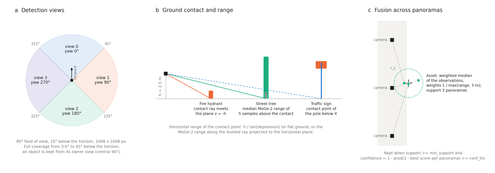
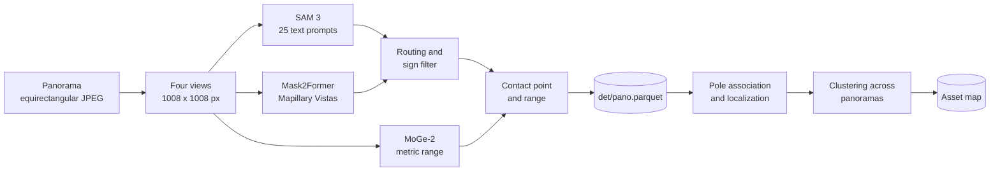

<p align="center"></p>

# StreetNet

[](https://huggingface.co/datasets/mehmetkeremturkcan/streetnet-nyc)
[](pyproject.toml)
[](LICENSE)

StreetNet builds an inventory of street assets from street-level panoramas. For each panorama it segments 22 classes
of street furniture and infrastructure, finds the point where each object meets the ground, measures its metric
range, and fuses the detections of neighbouring panoramas into one georeferenced point per asset. This repository
contains the inference pipeline: detection on GPUs, mapping on CPUs, and evaluation against reference inventories.

| | |
|---|---|
| Classes | 22: street lights, sign poles, traffic signals, traffic signs, bus stop signs, manhole covers, catch basins, curb ramps, fire hydrants, bollards, barriers, fire alarm boxes, trash cans, street trees, planters, bus shelters, bike racks, bike share docks, parking meters, benches, mailboxes, LinkNYC kiosks |
| Input | Equirectangular panoramas with camera position and heading; camera pitch and roll when available |
| Models | SAM 3 with 25 text prompts, Mask2Former Swin-L trained on Mapillary Vistas, MoGe-2 metric geometry |
| Output | One point per asset with class, support (number of panoramas), confidence and position source; the per-panorama detections with their geometry |
| Throughput | 0.9 s per panorama on one NVIDIA RTX PRO 6000 Blackwell Max-Q; 16,000 panoramas per hour on four |
| New York City | An asset map of the five boroughs, published as a dataset on Hugging Face |
| License | GNU Affero General Public License v3.0 or later |

Links:

- Asset map of New York City: <https://huggingface.co/datasets/mehmetkeremturkcan/streetnet-nyc>
- Method, with the pseudocode of each step: [docs/method.md](docs/method.md)
- Input and output formats: [docs/data.md](docs/data.md)
- Evaluation protocol and results: [docs/evaluation.md](docs/evaluation.md)
- Throughput and the optimizations behind it: [docs/performance.md](docs/performance.md)

## How it works





**Detection** runs once per panorama. The panorama is rendered as four perspective views, 90 degrees wide and
pitched 10 degrees down. SAM 3 segments all 25 text prompts in all four views in one batch. Curb ramps and catch
basins come from Mask2Former trained on Mapillary Vistas. The Mask2Former label map also checks traffic-sign and
bus-stop-sign detections: those on vehicles are removed, and those on signal heads are relabelled traffic signals,
or removed when a signal detection already covers them. Each detection is reduced to its ground-contact pixel, the
median column of the lowest rows of its mask, and its range is the median of five MoGe-2 range samples on a strip
2% to 12% of the box height above that pixel. The result is a table of detections per panorama.

**Mapping** places each detection in a metric map frame. Signs and signals hanging on a pole take the contact
point of the pole below them. Trees, street lights, signs, signals, benches and bike racks are placed at their
MoGe-2 range when it is available; the other classes, and range classes without a range, where the leveled
contact ray meets a flat ground plane 2.5 m below the camera. Manhole covers, catch basins and curb ramps use the
ray through the mask centroid. Detections of the same class from neighbouring panoramas within a class-specific
radius are clustered. The cluster's weighted median is the asset's position, refined by ray-aware least squares for
the 12 classes with `pos = aniso` when the support is at least 2; the number of distinct panoramas is the asset's
support, and 1 - prod(1 - best score per panorama) its confidence. Assets below the class's minimum support or
confidence are dropped. The city is processed in 1 km blocks with a 60 m halo, in parallel.

The parameters of 14 classes (clustering radius, maximum range, minimum support, confidence threshold) were tuned
against NYC Open Data on the development split (478 panoramas) of a pilot study of 10,180 panoramas in Upper
Manhattan; the 8 classes without a reference layer use hand-set values. [docs/method.md](docs/method.md) gives each
step as pseudocode with its constants. The figures of this README are drawn by `tools/figures/` from the published
map and the pipeline's parameters; they contain no street-level imagery.

## Install

Detection needs Linux, an NVIDIA GPU and Python 3.10 to 3.12 (SAM 3 requires numpy below 2.0); the New York City
run used 33 to 37 GB of GPU memory per process. Mapping and evaluation run on CPUs with Python 3.10 or newer.

Detection, mapping and evaluation:

```bash
git clone https://github.com/mkturkcan/streetnet.git
cd streetnet
pip install -e ".[detect]"
hf auth login                  # SAM 3 is gated: accept its license at https://huggingface.co/facebook/sam3 first
```

Mapping and evaluation:

```bash
pip install -e .
```

The checkpoints of the three models download on first use. MoGe installs `opencv-python`, which needs `libGL`; on
servers without it, such as CUDA containers, run `pip uninstall -y opencv-python && pip install opencv-python-headless`.
The tested configuration is Python 3.11, PyTorch 2.12 with CUDA 13.0, transformers 5.8.1, SAM 3 at commit `96914d2`
and MoGe at commit `925b8ed`.

## Quick start

```bash
# detect: one process per GPU, resumable; --compile compiles SAM 3 when each process starts
streetnet detect --index panos.parquet --images panoramas/ --out runs/city --gpus 0,1,2,3 --compile
streetnet status --index panos.parquet --run runs/city

# map: fuse the detections into assets
streetnet map --index panos.parquet --run runs/city --name city

# evaluate against reference points of the same classes (format: docs/data.md)
streetnet eval --index panos.parquet --map runs/city/map/city_assets.parquet --gt reference.parquet
```

The index has one row per panorama:

| Column | Meaning |
|---|---|
| `pano_id` | identifier; the image is `<images>/<pano_id>.jpg` unless an `image` column gives its path |
| `lat`, `lon` | camera position, WGS 84 |
| `heading` | compass bearing of the centre column of the panorama, degrees clockwise from north |
| `pitch`, `roll` | camera pitch and roll from the capture metadata, degrees (optional) |
| `nx`, `ny`, `nz` | ground up-normal in the camera frame, overriding pitch and roll (optional) |
| `h` | camera height above the ground in metres, 2.5 by default (optional) |

[docs/data.md](docs/data.md) describes the index, the reference points, the run folder and the columns of the
output tables.

## Classes

<!-- classes:start -->
| Class | Prompts (SAM 3) or source | Mount | Placement | Group |
|---|---|---|---|---|
| Street light | "street light pole" | ground | range | Lighting and poles |
| Sign pole | "sign pole" | ground | ground | Lighting and poles |
| Traffic signal | "traffic light", "pedestrian walk signal" | pole | range | Traffic control |
| Traffic sign | "traffic sign", "parking regulation sign", "street name sign" | pole | range | Traffic control |
| Bus stop sign | "bus stop sign" | pole | range | Traffic control |
| Manhole cover | "manhole cover" | surface | ground | Ground surface |
| Catch basin | Mask2Former-Vistas: Catch Basin | surface | ground | Ground surface |
| Curb ramp | Mask2Former-Vistas: Curb Cut | surface | ground | Ground surface |
| Fire hydrant | "fire hydrant" | ground | ground | Safety and emergency |
| Bollard | "bollard" | ground | ground | Safety and emergency |
| Barrier | "construction barrier" | ground | ground | Safety and emergency |
| Fire alarm box (experimental) | "fire alarm box" | ground | ground | Safety and emergency |
| Trash can | "trash can" | ground | ground | Sanitation |
| Street tree | "tree trunk" | ground | range | Greenery |
| Planter (experimental) | "planter" | ground | ground | Greenery |
| Bus shelter | "bus stop shelter" | ground | ground | Transit and mobility |
| Bike rack | "bike rack" | ground | range | Transit and mobility |
| Bike share dock (experimental) | "bike share docking station" | ground | ground | Transit and mobility |
| Parking meter (experimental) | "parking pay station", "parking meter" | ground | ground | Transit and mobility |
| Bench | "bench" | ground | range | Amenities |
| Mailbox | "mailbox" | ground | ground | Amenities |
| LinkNYC kiosk | "LinkNYC kiosk" | ground | ground | Amenities |
<!-- classes:end -->

Placement: range classes are placed at the MoGe-2 range along the contact ray, ground classes where that ray meets
the ground plane; pole-mounted classes use the contact point of the pole below them. Experimental classes had a
precision below 0.67 in the pilot study's visual audit of up to 12 detections per class (fire alarm box 2 of 7,
parking meter 4 of 12, planter 7 of 12) or were not audited (bike share dock). The pedestrian signal prompt is
merged into traffic signals. `streetnet map` also writes utility poles, which serve as pole carriers for signs; the
published map leaves them out, because none of 12 audited utility-pole detections in the pilot was a utility pole.

## New York City

The index of the New York City run has 1,170,687 panoramas of the five boroughs. They are processed on four GPUs in
order of plan level: for Web Mercator zoom levels z = 14 to 22, with cells of edge 40,075 km x cos(latitude) / 2^z
(1.85 km at z = 14, 116 m at z = 18, 29 m at z = 20, 7 m at z = 22), each cell that holds no panorama selected at a
coarser level contributes the panorama nearest its centre, which gets plan level z; the remaining panoramas get
level 23. The
panoramas up to a complete level form an even sample of the city. Each published version of the map states the
panoramas it was built from.

<!-- nyc:start -->
Version v0.1 (preview, plan levels up to 18): 629,271 assets in 22 classes from 52,269 panoramas captured between 2007 and 2026. Plan levels up to 18 (one panorama per cell of about 116 m) across the five boroughs; minimum support capped at 1.

The evaluation region is the union of 15 m disks around the 722 mapped panoramas that lie within 20 m of a panorama of the Upper Manhattan pilot study and at least 30 m from its development split, on which the fusion parameters were tuned. Over 4,153 ground-truth assets of NYC Open Data in that region, the map has precision 0.281, recall 0.293 and F1 0.287 at a matching radius of 3 m:

| Class | Ground truth | Predicted | Precision | Recall | F1 |
|---|---:|---:|---:|---:|---:|
| Street tree | 1,457 | 1,591 | 0.521 | 0.564 | 0.542 |
| Traffic sign | 913 | 634 | 0.146 | 0.101 | 0.119 |
| Sign pole | 485 | 306 | 0.039 | 0.025 | 0.030 |
| Street light | 351 | 781 | 0.097 | 0.217 | 0.134 |
| Curb ramp | 307 | 219 | 0.542 | 0.378 | 0.445 |
| Fire hydrant | 186 | 115 | 0.426 | 0.263 | 0.326 |
| Catch basin | 176 | 113 | 0.186 | 0.119 | 0.145 |
| Bike rack | 129 | 71 | 0.070 | 0.039 | 0.050 |
| Trash can | 51 | 314 | 0.029 | 0.176 | 0.049 |
| Parking meter | 29 | 16 | 0.125 | 0.069 | 0.089 |
| Fire alarm box | 23 | 2 | 0.000 | 0.000 | 0.000 |
| Bench | 19 | 182 | 0.055 | 0.526 | 0.100 |
| Bus shelter | 14 | 7 | 0.429 | 0.214 | 0.286 |
| LinkNYC kiosk | 13 | 0 | n/a | 0.000 | n/a |
| All classes | 4,153 | 4,351 | 0.281 | 0.293 | 0.287 |
<!-- nyc:end -->

The asset map, the reference points and the evaluation region are published in the
[dataset](https://huggingface.co/datasets/mehmetkeremturkcan/streetnet-nyc), which contains no imagery.
[docs/evaluation.md](docs/evaluation.md) describes the protocol and the reference layers.

## Performance

| Stage, per panorama | GPU time |
|---|---:|
| SAM 3, 4 views x 25 prompts in one batch, lazy mask head, compiled | 0.45 s |
| Mask2Former Swin-L, 4 views at 1024 px | 0.27 s |
| MoGe-2, 4 views, float16 | 0.14 s |

With decoding, rendering and CPU work overlapped, a panorama takes 0.9 s of wall-clock time per GPU. Measured on an
NVIDIA RTX PRO 6000 Blackwell Max-Q. [docs/performance.md](docs/performance.md) lists the optimizations and their
measured effect on the detections.

## Repository layout

```
streetnet/
├── streetnet/
│   ├── cli.py                command line: detect, map, eval, status
│   ├── detect.py             per-panorama pipeline, GPU and CPU stages, multi-GPU launcher
│   ├── models/               SAM 3 (batched, lazy mask head), Mask2Former-Vistas, MoGe-2
│   ├── geometry.py           equirectangular and pinhole cameras, leveling, view rendering
│   ├── instances.py          detection records: contact point, rays, flags
│   ├── signs.py              sign filter
│   ├── fusion.py             pole association, localization, clustering
│   ├── mapping.py            block-parallel city map
│   ├── evaluate.py           matching against reference points
│   ├── index.py              panorama index, map projection
│   ├── vocabulary.py         prompts, classes and mount types
│   └── configs/              prompts, fusion parameters, class table
├── tools/                    dataset export, README tables, figures
├── tests/                    unit and end-to-end tests on a synthetic street
└── docs/                     method, data formats, evaluation, performance
```

## Tests

```bash
pip install -e ".[dev]"
pytest -q
```

The tests run on CPUs and need no model weights. A synthetic street with three cameras and known asset positions
checks localization, clustering, the map stage, and the `map` and `eval` commands.

## Licensing

- **Code:** GNU Affero General Public License v3.0 or later ([LICENSE](LICENSE)).
- **New York City asset map:** CC BY-NC 4.0, on Hugging Face. The reference points come from NYC Open Data.
- **Models**, downloaded on first use under their own terms: SAM 3 under the SAM License
  ([facebook/sam3](https://huggingface.co/facebook/sam3)); Mask2Former Swin-L trained on Mapillary Vistas, whose
  [model card](https://huggingface.co/facebook/mask2former-swin-large-mapillary-vistas-panoptic) lists the license as
  "other" (the Mask2Former code is MIT-licensed); MoGe-2 under the MIT License
  ([Ruicheng/moge-2-vitl-normal](https://huggingface.co/Ruicheng/moge-2-vitl-normal)).
- **Imagery:** the New York City map was made from Google Street View panoramas. Neither the repository nor the
  dataset includes street-level imagery.

## Citation

```bibtex
@software{turkcan2026streetnet,
  author  = {Turkcan, Mehmet Kerem},
  title   = {{StreetNet}: street-asset maps from street-level panoramas},
  year    = {2026},
  version = {0.1.0},
  url     = {https://github.com/mkturkcan/streetnet}
}
```
