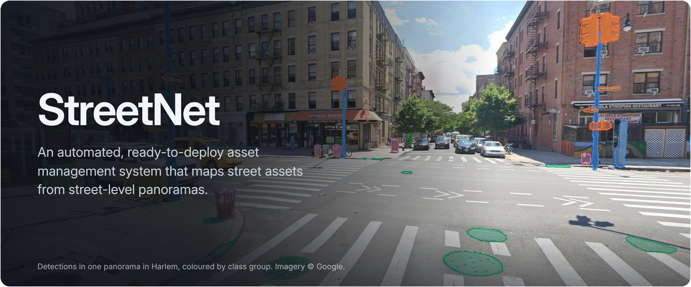
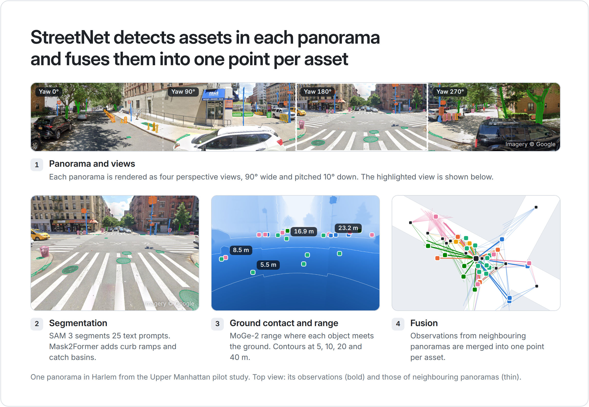
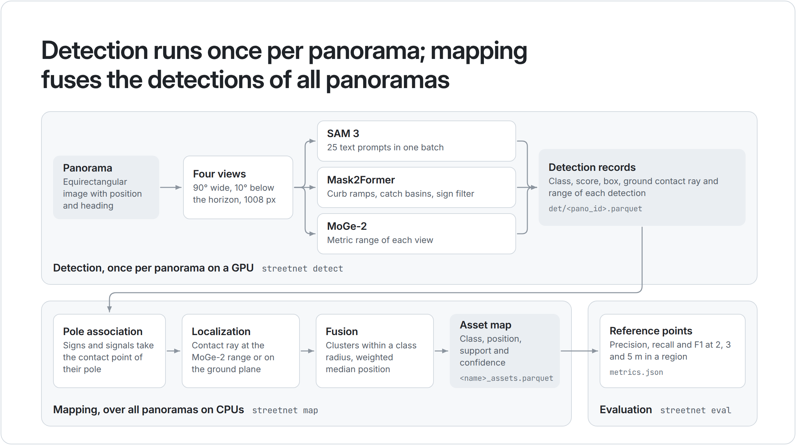
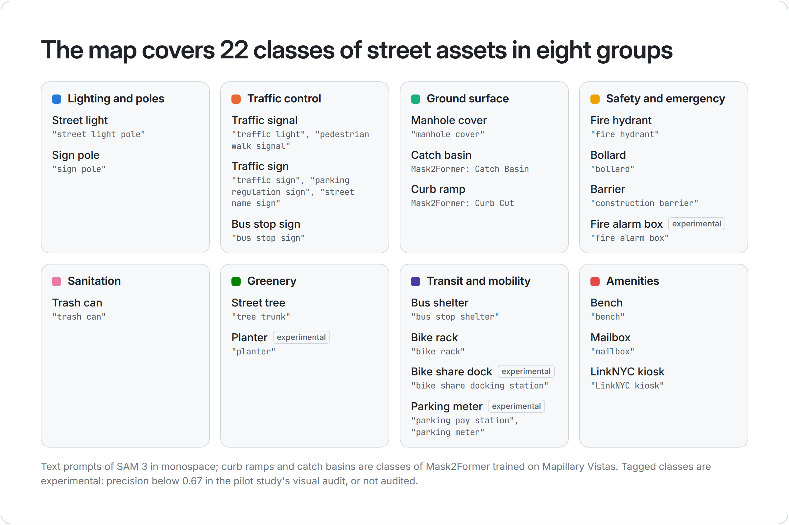
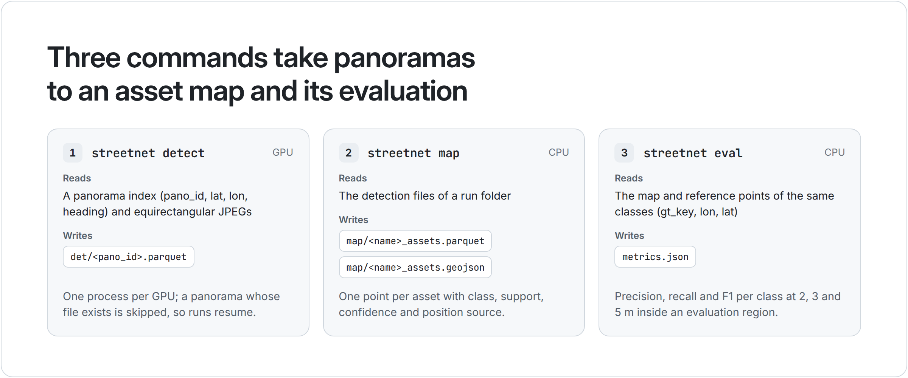

<picture>
  <source media="(prefers-color-scheme: dark)" srcset="docs/assets/figures/hero-dark.jpg">
  
</picture>

StreetNet maps street assets from street-level panoramas. It segments 22 classes of street furniture and
infrastructure in each panorama, measures where each object meets the ground, and fuses the detections of
neighbouring panoramas into one georeferenced point per asset.

[](https://github.com/mkturkcan/streetnet/actions/workflows/ci.yml)
[](https://huggingface.co/datasets/mehmetkeremturkcan/streetnet-nyc)
[](pyproject.toml)
[](LICENSE)

**[Project page](https://mkturkcan.github.io/streetnet/)** &emsp; **[Method](docs/method.md)** &emsp;
**[Data formats](docs/data.md)** &emsp; **[Evaluation](docs/evaluation.md)** &emsp;
**[New York City map](https://huggingface.co/datasets/mehmetkeremturkcan/streetnet-nyc)** &emsp; **[Citation](#citation)**

## Quickstart

```bash
git clone https://github.com/mkturkcan/streetnet.git && cd streetnet
pip install -e ".[detect]"     # detection: Linux, an NVIDIA GPU, Python 3.10 to 3.12
hf auth login                  # SAM 3 is gated: accept its license at huggingface.co/facebook/sam3 first
```

```bash
streetnet detect --index panos.parquet --images panoramas/ --out runs/city --gpus 0,1,2,3
streetnet map --index panos.parquet --run runs/city --name city
streetnet eval --index panos.parquet --map runs/city/map/city_assets.parquet --gt reference.parquet
```

The index has one row per panorama with `pano_id`, `lat`, `lon` and `heading`; the reference points have `gt_key`,
`lon` and `lat` ([data formats](docs/data.md)). Mapping and evaluation run on CPUs and install with `pip install -e .`

<details>
<summary>Installation notes</summary>

- The checkpoints of SAM 3, Mask2Former and MoGe-2 download on first use.
- SAM 3 requires numpy below 2.0. The New York City run used 33 to 37 GB of GPU memory per process.
- MoGe installs `opencv-python`, which needs `libGL`. On servers without it, such as CUDA containers:
  `pip uninstall -y opencv-python && pip install opencv-python-headless`.
- `--compile` compiles SAM 3 when each process starts. `streetnet status --index panos.parquet --run runs/city`
  reports the progress of a run.
- Tested with Python 3.11, PyTorch 2.12 with CUDA 13.0, transformers 5.8.1, SAM 3 at commit `96914d2` and MoGe
  at commit `925b8ed`.

</details>

## Videos

<a href="https://mkturkcan.github.io/streetnet/#videos"></a>

## How it works

<picture>
  <source media="(prefers-color-scheme: dark)" srcset="docs/assets/figures/overview-dark.jpg">
  
</picture>

Each panorama is rendered as four perspective views. SAM 3 segments 25 text prompts, Mask2Former adds curb ramps and
catch basins, and MoGe-2 measures the range where each object meets the ground.

<picture>
  <source media="(prefers-color-scheme: dark)" srcset="docs/assets/figures/pipeline-dark.png">
  
</picture>

Detection writes one table of detections per panorama. Mapping places them in a metric frame and clusters them, in
blocks of 1 km that run in parallel.

<picture>
  <source media="(prefers-color-scheme: dark)" srcset="docs/assets/figures/placement-dark.png">
  
</picture>

Trees, street lights, signs, signals, benches and bike racks are placed at their MoGe-2 range when it is available,
the other classes on a ground plane 2.5 m below the camera. [docs/method.md](docs/method.md) gives each step as pseudocode with its constants.

## Classes

<picture>
  <source media="(prefers-color-scheme: dark)" srcset="docs/assets/figures/classes-dark.png">
  
</picture>

Twenty classes are defined by text prompts in [`streetnet/configs/prompts.json`](streetnet/configs/prompts.json), so
a run can use another vocabulary (`--vocabulary`); curb ramps and catch basins come from Mask2Former. The
[class table](docs/method.md#classes) lists the mount and placement of each class.

## New York City

<picture>
  <source media="(prefers-color-scheme: dark)" srcset="docs/assets/figures/nyc_map-dark.jpg">
  
</picture>

<!-- nyc:start -->
Version v0.2 (plan levels up to 20): 4,265,125 assets in 22 classes from 401,419 panoramas captured between 2007 and 2026. F1 0.293 at a matching radius of 3 m over 29,806 reference assets of NYC Open Data ([per-class results](docs/evaluation.md#results)).
<!-- nyc:end -->

The asset map, its reference points and the evaluation region are published as a
[dataset on Hugging Face](https://huggingface.co/datasets/mehmetkeremturkcan/streetnet-nyc), which contains no
imagery. The run covers 1,170,687 panoramas of the five boroughs, processed from coarse to fine spatial sampling;
each version of the map states the panoramas it was built from.

## Outputs

<picture>
  <source media="(prefers-color-scheme: dark)" srcset="docs/assets/figures/run-dark.png">
  
</picture>

[docs/data.md](docs/data.md) describes the index, the reference points, the run folder and the columns of each table.

## Documentation

| Page | Contents |
|---|---|
| [Project page](https://mkturkcan.github.io/streetnet/) | Videos, figures, classes, results and the quickstart |
| [Method](docs/method.md) | Pseudocode of each step, the per-class parameters and their tuning |
| [Data formats](docs/data.md) | Index, reference points, run folder, detection and asset tables |
| [Evaluation](docs/evaluation.md) | Matching protocol, reference layers, evaluation region and results |
| [Performance](docs/performance.md) | Throughput on four GPUs and the optimizations behind it |

<details>
<summary>Repository layout</summary>

```
streetnet/
├── streetnet/
│   ├── cli.py                command line: detect, map, eval, status
│   ├── detect.py             per-panorama pipeline, GPU and CPU stages, multi-GPU launcher
│   ├── models/               SAM 3 (batched, lazy mask head), Mask2Former-Vistas, MoGe-2
│   ├── geometry.py           equirectangular and pinhole cameras, leveling, view rendering
│   ├── instances.py          detection records: contact point, rays, flags
│   ├── signs.py              sign filter
│   ├── fusion.py             pole association, localization, clustering
│   ├── mapping.py            block-parallel city map
│   ├── evaluate.py           matching against reference points
│   ├── index.py              panorama index, map projection
│   ├── vocabulary.py         prompts, classes and mount types
│   └── configs/              prompts, fusion parameters, class table
├── tools/                    dataset export, tables, figures and project page
├── tests/                    unit and end-to-end tests on a synthetic street
└── docs/                     project page, method, data formats, evaluation, performance
```

</details>

## Tests

```bash
pip install -e ".[dev]" && pytest -q
```

The tests run on CPUs without model weights: a synthetic street with three cameras and known asset positions checks
localization, clustering, the map stage and the `map` and `eval` commands.

## License

- **Code:** GNU Affero General Public License v3.0 or later ([LICENSE](LICENSE)).
- **New York City asset map:** CC BY-NC 4.0, on Hugging Face. The reference points come from NYC Open Data.
- **Models**, downloaded on first use under their own terms: SAM 3 under the SAM License
  ([facebook/sam3](https://huggingface.co/facebook/sam3)); Mask2Former Swin-L trained on Mapillary Vistas, whose
  [model card](https://huggingface.co/facebook/mask2former-swin-large-mapillary-vistas-panoptic) lists the license as
  "other" (the Mask2Former code is MIT-licensed); MoGe-2 under the MIT License
  ([Ruicheng/moge-2-vitl-normal](https://huggingface.co/Ruicheng/moge-2-vitl-normal)).
- **Imagery:** the panoramas are Google Street View imagery (Imagery © Google). The figures and videos show parts
  of panoramas to describe the method. The repository and the dataset contain no panoramas or panorama identifiers.
- **Fonts** of the figures and the project page: Inter and JetBrains Mono, SIL Open Font License
  ([docs/assets/fonts](docs/assets/fonts)).

## Citation

```bibtex
@software{turkcan2026streetnet,
  author  = {Turkcan, Mehmet Kerem},
  title   = {{StreetNet}: street asset maps from street-level panoramas},
  year    = {2026},
  version = {0.1.0},
  url     = {https://github.com/mkturkcan/streetnet}
}
```
